### Escuela Colombiana de Ingeniería
### Arquitecturas de Software - ARSW

# Informe de laboratorio: Escalamiento en Azure con máquinas virtuales y balanceador de carga

**Escenario de calidad (Parte 0).** Cuando varios usuarios consultan de forma concurrente un enésimo número de Fibonacci superior a 1.000.000 en condiciones normales, **todas las peticiones deben responderse y la CPU no puede superar el 70 %**.

**Nota sobre los tamaños de VM.** La guía menciona `B1ls` y `B2ms`. En el portal, para la suscripción *Azure for Students* y la región *Spain Central*, se trabajó con tamaños de la serie B v2: `Standard_B2ats_v2` (2 vCPU, 1 GiB, US$ 8,91/mes) como tamaño inicial y `Standard_B2als_v2` (2 vCPU, 4 GiB, US$ 35,70/mes) como tamaño escalado (ver [p2](#11-crear-la-máquina-virtual) y [p15](#110-escalar-verticalmente-la-vm)).

---

# Parte 1 - Escalabilidad vertical

## 1.1 Crear la máquina virtual

**Paso 1 del lab.** Se crea la VM desde el portal de Azure con la configuración básica pedida: grupo de recursos `SCALABILITY_LAB`, nombre `VERTICAL-SCALABILITY`, imagen Ubuntu Server.

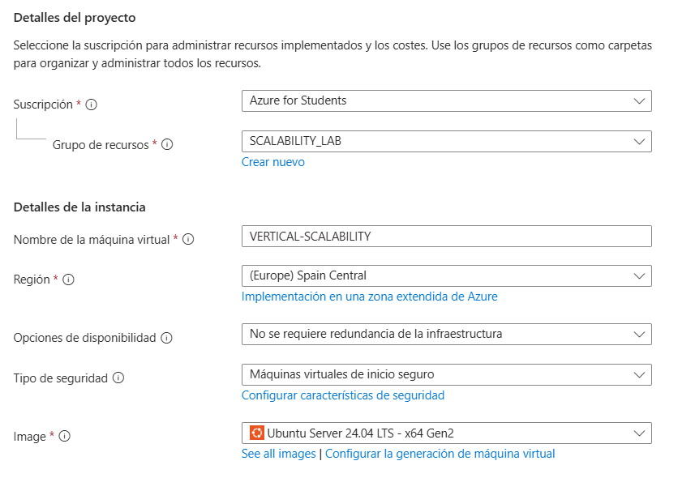

*Detalles del proyecto e instancia: suscripción Azure for Students, grupo de recursos `SCALABILITY_LAB`, región Spain Central, sin redundancia de infraestructura, inicio seguro e imagen **Ubuntu Server 24.04 LTS x64 Gen2**.*

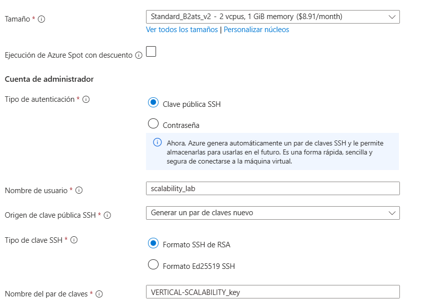

*Tamaño `Standard_B2ats_v2` (2 vCPU, 1 GiB de memoria, US$ 8,91/mes), autenticación por **clave pública SSH**, usuario `scalability_lab` y un par de claves RSA nuevo llamado `VERTICAL-SCALABILITY_key`.*

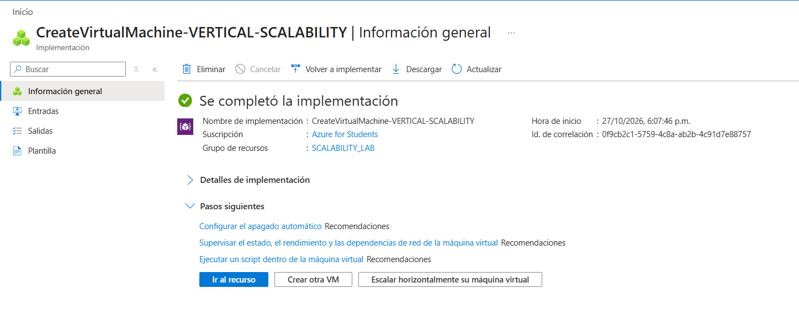

*La implementación `CreateVirtualMachine-VERTICAL-SCALABILITY` terminó correctamente (se inició el 27/10/2026 a las 6:07 p. m.).*

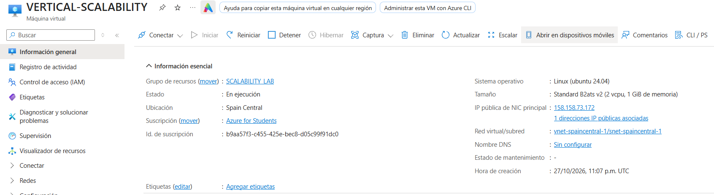

*Vista general de la VM ya en ejecución: Linux (Ubuntu 24.04), tamaño B2ats v2, IP pública **158.158.73.172** y red virtual/subred `vnet-spaincentral-1/snet-spaincentral-1`. Esa IP es la que se usa en el resto de la parte 1.*

## 1.2 Conexión por SSH

**Paso 2 del lab.**

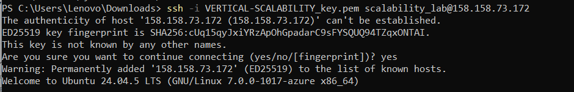

*Conexión con `ssh -i VERTICAL-SCALABILITY_key.pem scalability_lab@158.158.73.172`. Se aceptó la huella de la llave del host y el servidor respondió con el mensaje de bienvenida de Ubuntu 24.04.5 LTS.*

## 1.3 Instalación de Node.js con NVM

**Paso 3 del lab.**

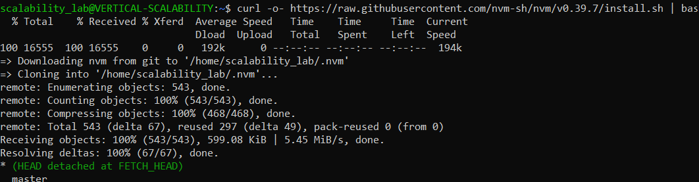

*Descarga y ejecución del script de instalación de NVM (v0.39.7) con `curl`, que clona NVM en `~/.nvm`.*

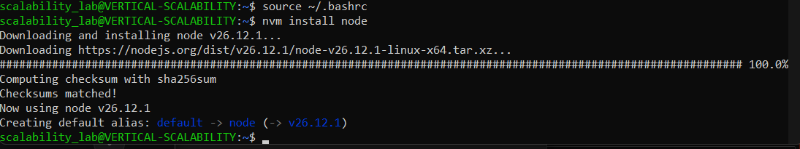

*Después de `source ~/.bashrc`, `nvm install node` descarga e instala Node.js **v26.12.1** y lo deja como versión por defecto.*

## 1.4 Instalación de la aplicación

**Paso 4 del lab.**

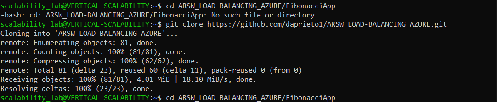

*Se ejecuta `git clone` del repositorio base del curso y el `cd` ya funciona. Desde esa carpeta se instalan las dependencias con `npm install` y se arranca con `node FibonacciApp.js`.*

## 1.5 Abrir el puerto 3000 y verificar el servicio

**Pasos 5 y 6 del lab.** Por defecto el grupo de seguridad de red (NSG) bloquea el tráfico entrante, así que hay que crear una regla de entrada para el puerto de la aplicación.

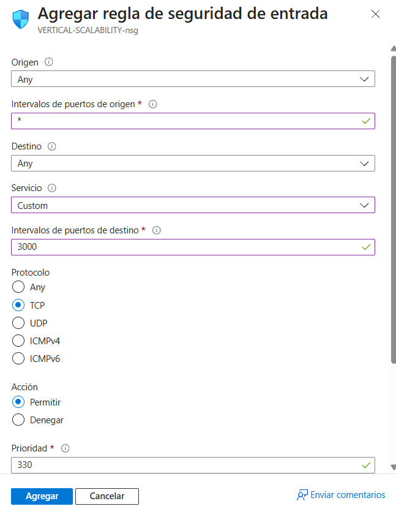

*Regla de seguridad de entrada en `VERTICAL-SCALABILITY-nsg`: origen *Any*, puerto de destino **3000**, protocolo **TCP**, acción **Permitir**, prioridad 330.*

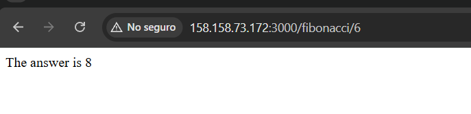

*Con la regla creada, `http://158.158.73.172:3000/fibonacci/6` responde **`The answer is 8`**, tal como pedía el lab.*

## 1.6 Tiempos de respuesta del endpoint

**Paso 7 del lab.** Se consultó `/fibonacci/<n>` para los diez valores pedidos (1.000.000 a 1.090.000) y se midió el tiempo de cada respuesta con un cronómetro al lado del navegador.

<table>
<tr>
<td align="center">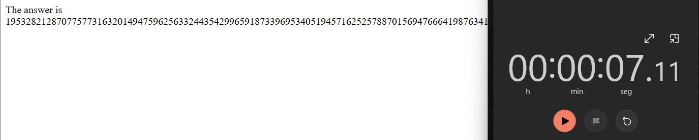 <b>n = 1.000.000 → 7,11 s</b></td>
<td align="center">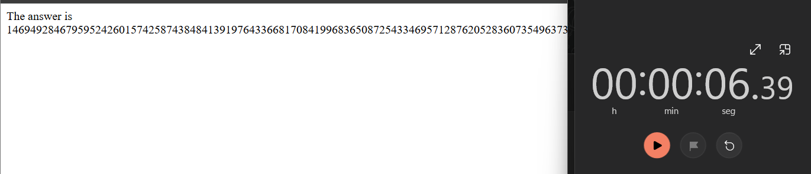 <b>n = 1.010.000 → 6,39 s</b></td>
</tr>
<tr>
<td align="center">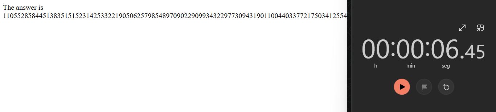 <b>n = 1.020.000 → 6,45 s</b></td>
<td align="center">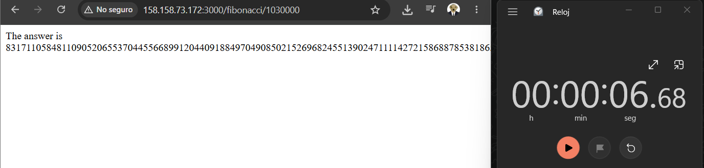 <b>n = 1.030.000 → 6,68 s</b></td>
</tr>
<tr>
<td align="center">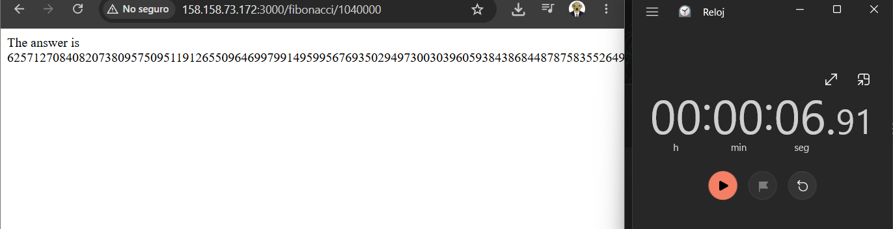 <b>n = 1.040.000 → 6,91 s</b></td>
<td align="center">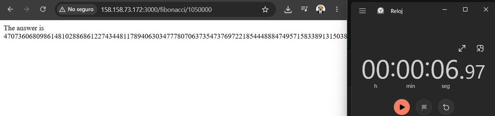 <b>n = 1.050.000 → 6,97 s</b></td>
</tr>
<tr>
<td align="center">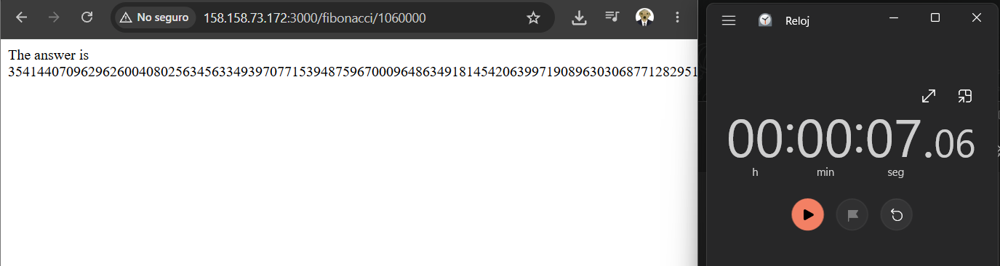 <b>n = 1.060.000 → 7,06 s</b></td>
<td align="center">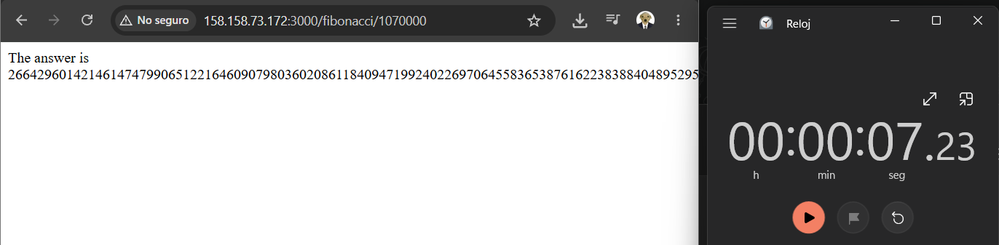 <b>n = 1.070.000 → 7,23 s</b></td>
</tr>
<tr>
<td align="center">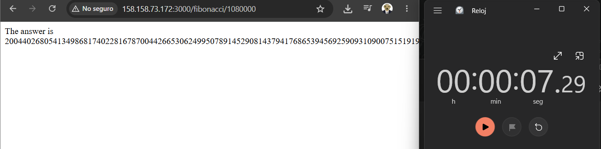 <b>n = 1.080.000 → 7,29 s</b></td>
<td align="center">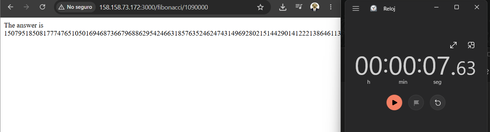 <b>n = 1.090.000 → 7,63 s</b></td>
</tr>
</table>

| n | Tiempo de respuesta |
|---|---|
| 1.000.000 | 7,11 s |
| 1.010.000 | 6,39 s |
| 1.020.000 | 6,45 s |
| 1.030.000 | 6,68 s |
| 1.040.000 | 6,91 s |
| 1.050.000 | 6,97 s |
| 1.060.000 | 7,06 s |
| 1.070.000 | 7,23 s |
| 1.080.000 | 7,29 s |
| 1.090.000 | 7,63 s |

**Interpretación.** Desde la segunda consulta el tiempo crece de forma sostenida con `n` (de 6,39 s a 7,63 s); la primera consulta (7,11 s) es algo más lenta, probablemente por ser la primera ejecución en frío. La función es lenta porque calcula Fibonacci con un ciclo de `n` iteraciones que suma enteros de precisión arbitraria (`big-integer`): el resultado de F(1.000.000) tiene cerca de 209.000 dígitos (la respuesta pesa ~209 kB, ver [p14](#19-resultados-de-la-carga-concurrente)), por lo que cada suma cuesta más a medida que el número crece. Además, el cálculo es **síncrono y se ejecuta en el único hilo de Node.js**: mientras una petición se calcula, las demás esperan.

## 1.7 Consumo de CPU de la VM

**Paso 8 del lab.**

*Métricas de la VM en el portal tras las consultas anteriores: disponibilidad 1 y uso promedio de CPU de **2,16 %**, con un pequeño pico al final de la gráfica. Azure tarda unos minutos en reflejar las métricas, por eso el pico aparece desfasado respecto de las consultas.*

## 1.8 Pruebas de carga con Newman

**Paso 9 del lab.** Se editó el ambiente de Postman con la IP de la VM y se ejecutó la colección con `newman ... -n 10`.

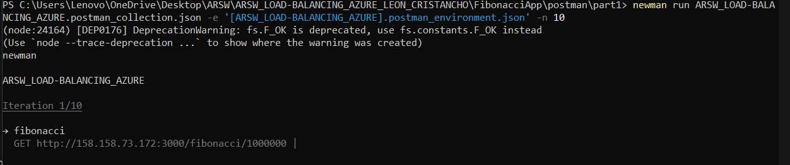

*Inicio de Newman desde la carpeta `FibonacciApp/postman/part1`. Cada iteración hace `GET http://158.158.73.172:3000/fibonacci/1000000`. Esta ejecución individual es la base de comparación.*

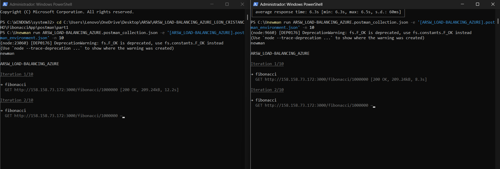

*Dos ventanas de PowerShell lanzan Newman **en paralelo**. Las primeras respuestas ya tardan más que en una sola ejecución: 12,2 s en la ventana izquierda y 8,3 s en la derecha. En la parte superior de la ventana derecha se alcanza a ver el resumen de una ejecución anterior, con promedio de 6,3 s (mín. 6,3 s, máx. 6,5 s).*

## 1.9 Resultados de la carga concurrente

| Métrica (20 peticiones en total) | Ventana izquierda | Ventana derecha |
|---|---|---|
| Peticiones ejecutadas | 10 | 10 |
| **Peticiones fallidas** | **2** (iteraciones 5 y 9) | **3** (iteraciones 2, 4 y 9) |
| Duración total | 1 m 32,1 s | 1 m 21,9 s |
| Tiempo promedio | 9,9 s | 9,1 s |
| Mínimo / máximo | 6,3 s / 17,7 s | 6,4 s / 12,3 s |
| Desviación estándar | 3,8 s | 2,3 s |
| Datos recibidos | 1,67 MB | 1,46 MB |

**Interpretación.** Sin concurrencia cada petición tarda cerca de 6,3 s; con dos ejecuciones simultáneas el promedio sube a 9,1–9,9 s y el máximo llega a 17,7 s, porque las peticiones se encolan detrás del cálculo que ya está en curso. Además fallaron **5 de 20 peticiones (25 %)** con `read ECONNRESET`: la conexión se cerró antes de recibir respuesta, lo que es coherente con un proceso Node.js saturado, que no alcanza a atender a todos los clientes. Solo 15 de 20 peticiones (75 %) se respondieron, por lo que **con este tamaño de VM no se cumple** la parte del escenario de calidad que exige responder todas las peticiones.

## 1.10 Escalar verticalmente la VM

**Paso 10 del lab.** Para mitigar el problema se aumenta el tamaño de la VM desde la sección *Size*.

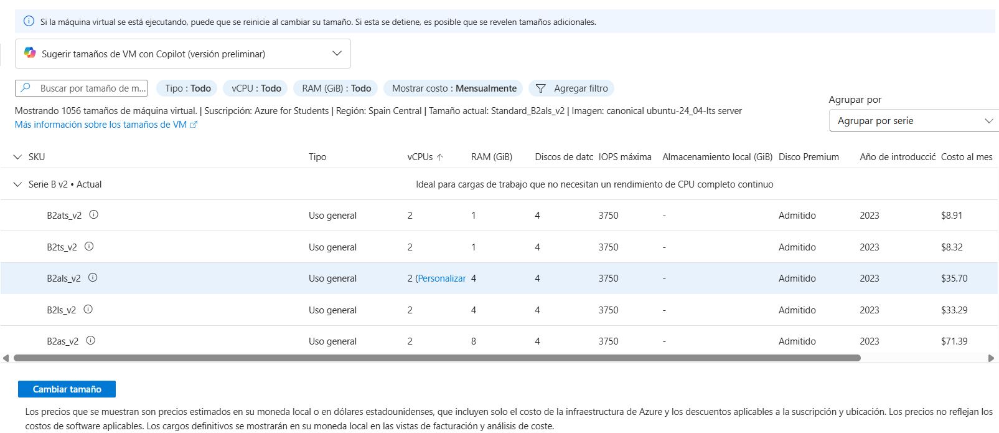

*Selector de tamaños de la serie B v2 en Spain Central. Se elige `Standard_B2als_v2` (2 vCPU, 4 GiB, US$ 35,70/mes) frente al `B2ats_v2` inicial (1 GiB, US$ 8,91/mes). El portal advierte que **la VM puede reiniciarse al cambiar de tamaño**.*

## 1.11 Repetir mediciones tras el escalamiento

**Paso 11 del lab.**

---

# Parte 2 - Escalabilidad horizontal

En esta parte se crea un nuevo grupo de recursos, `SCALABILITY_LAB_HORIZONTAL`, con un balanceador de carga que reparte las peticiones entre varias VMs iguales.

## 2.1 Crear el balanceador de carga

**Paso 1 del lab.**

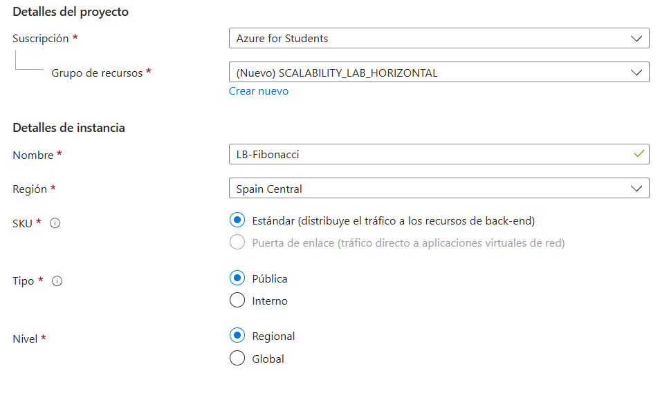

*Datos básicos del balanceador `LB-Fibonacci` en Spain Central: SKU **Estándar**, tipo **Público** y nivel **Regional**, dentro del grupo de recursos nuevo `SCALABILITY_LAB_HORIZONTAL`.*

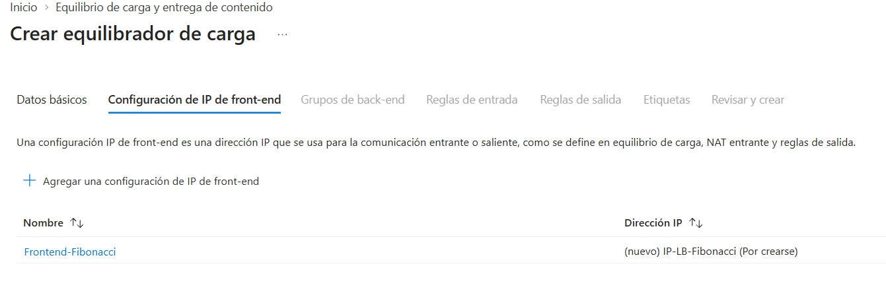

*Configuración de la IP de front-end: `Frontend-Fibonacci`, asociada a una IP pública nueva (`IP-LB-Fibonacci`). Es la dirección que usarán los clientes.*

## 2.2 Crear la red virtual

**Paso 5 del lab.** Se crea antes del *Backend Pool* porque el pool debe referenciar una red virtual existente.

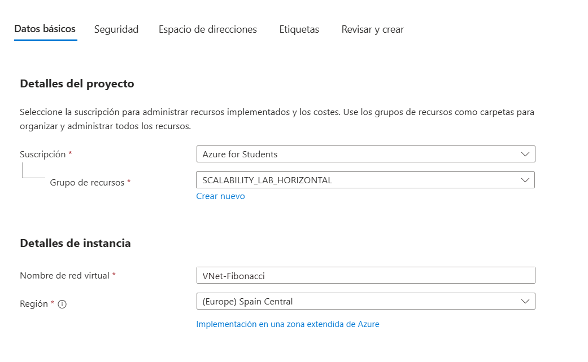

*Red virtual `VNet-Fibonacci` en el grupo `SCALABILITY_LAB_HORIZONTAL` y región Spain Central.*

## 2.3 Backend Pool, Health Probe y Load Balancing Rule

**Pasos 2, 3 y 4 del lab.**

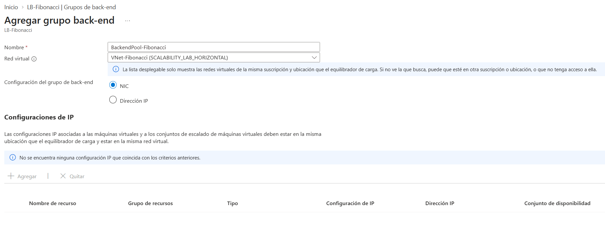

*Grupo de back-end `BackendPool-Fibonacci`, asociado a `VNet-Fibonacci` y configurado por **NIC**. Aún aparece vacío («No se encuentra ninguna configuración IP») porque todavía no existen las VMs.*

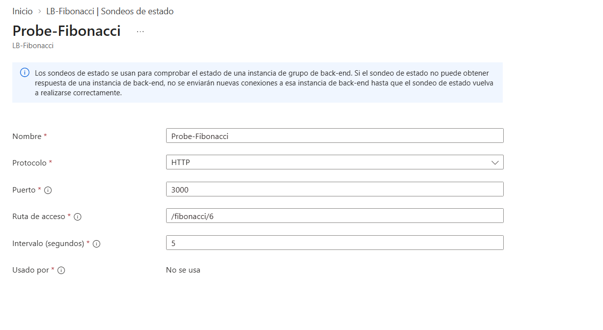

*Sondeo de estado `Probe-Fibonacci`: protocolo **HTTP**, puerto **3000**, ruta `/fibonacci/6`, intervalo de **5 segundos**. Si un nodo deja de responder, el balanceador deja de enviarle conexiones nuevas.*

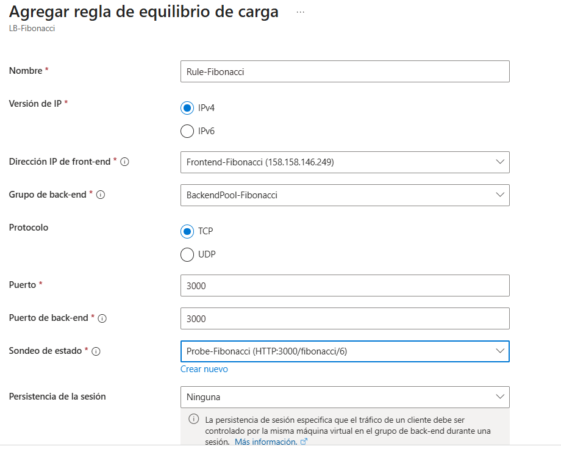

*Regla de equilibrio `Rule-Fibonacci`: IPv4, front-end `Frontend-Fibonacci` (IP **158.158.146.249**), grupo `BackendPool-Fibonacci`, TCP con puerto 3000 hacia el puerto de back-end 3000, el sondeo `Probe-Fibonacci` y **persistencia de sesión: Ninguna**. Por eso el endpoint del balanceador incluye `:3000`.*

## 2.4 Crear las máquinas virtuales (nodos)

**Pasos 1 a 4 del lab.** Se crean tres VMs (`VM1-Fibonacci`, `VM2-Fibonacci`, `VM3-Fibonacci`) en zonas de disponibilidad distintas y se registran en el balanceador.

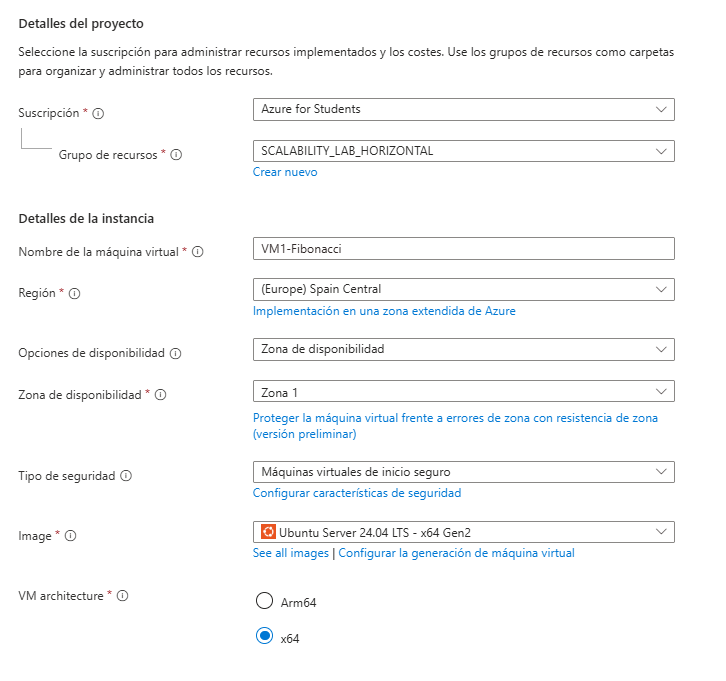

*Configuración básica de `VM1-Fibonacci`: grupo `SCALABILITY_LAB_HORIZONTAL`, Spain Central, opción de disponibilidad **Zona de disponibilidad**, **Zona 1**, Ubuntu Server 24.04 LTS x64.*

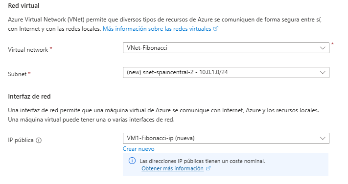

*Red de la VM: se selecciona `VNet-Fibonacci`, una subred nueva `snet-spaincentral-2` (10.0.1.0/24) y una IP pública nueva (`VM1-Fibonacci-ip`).*

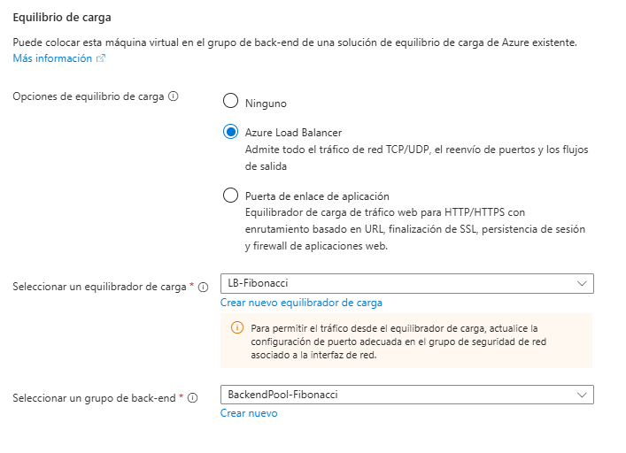

*Sección de equilibrio de carga: se elige **Azure Load Balancer**, el balanceador `LB-Fibonacci` y el grupo de back-end `BackendPool-Fibonacci`. El portal recuerda que hay que permitir el puerto en el NSG de la interfaz de red.*

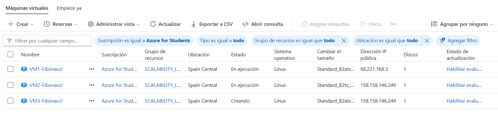

*Listado de las tres VMs en Spain Central: `VM1-Fibonacci` y `VM2-Fibonacci` en ejecución, y `VM3-Fibonacci` todavía en estado «Creando». Los tamaños mostrados son de la serie B v2 (`B2ats`/`B2ts`).*

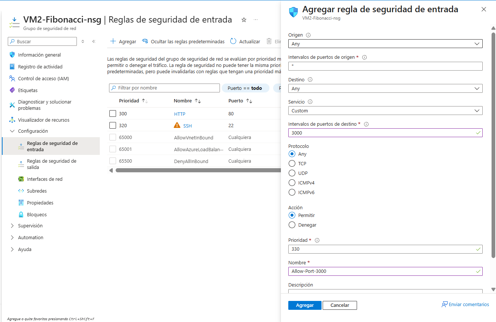

*Regla de entrada en `VM2-Fibonacci-nsg` para habilitar el tráfico al puerto **3000**: acción **Permitir**, prioridad 330, nombre `Allow-Port-3000`. Junto a ella se ven las reglas de HTTP (80) y SSH (22) y las reglas por defecto, entre ellas `DenyAllInBound`.*

Después se instaló la aplicación en cada nodo con los comandos de la guía (`git clone`, instalación de NVM y Node, `npm install` y `forever start FibonacciApp.js`).

## 2.5 Probar el resultado final

**Paso 1 de «Probar el resultado final».**

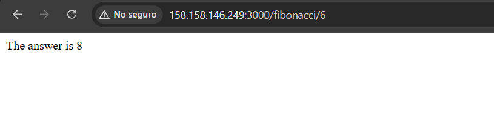

*Se consulta el balanceador (IP **158.158.146.249**) en `http://158.158.146.249:3000/fibonacci/6` y responde **`The answer is 8`**, lo que confirma que el tráfico llega a la aplicación a través del balanceador.*

## 2.6 Pruebas de carga con Newman

**Paso 2 del lab.** Se repiten las pruebas de la parte 1, ahora contra el balanceador.

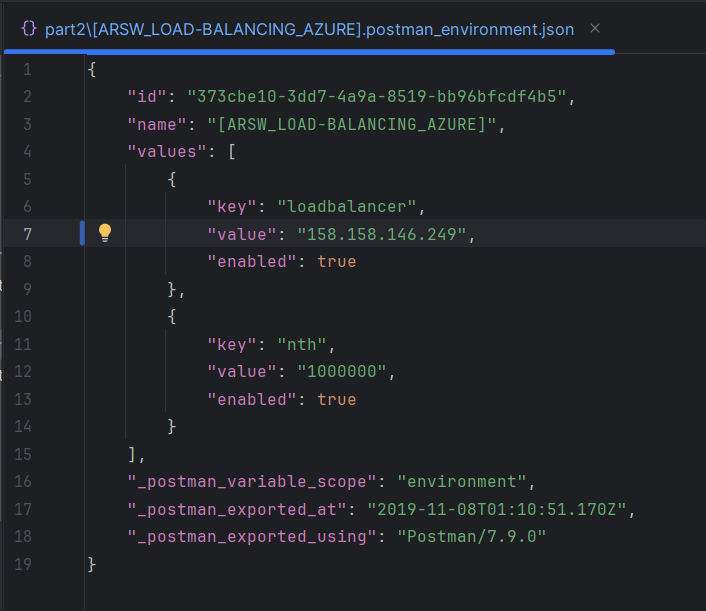

*Archivo de ambiente de Postman de `part2`: la variable `loadbalancer` apunta a la IP pública del balanceador (`158.158.146.249`) y `nth` vale `1000000`.*

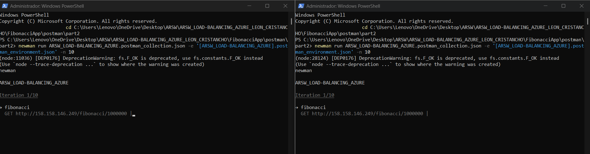

*Dos ventanas de PowerShell lanzan Newman en paralelo (`-n 10` cada una) contra `http://158.158.146.249/fibonacci/1000000`.*

| Métrica (20 peticiones en total) | Ventana izquierda | Ventana derecha |
|---|---|---|
| Peticiones ejecutadas | 10 | 10 |
| **Peticiones fallidas** | **0** | **0** |
| Duración total | 1 m 3,8 s | 1 m 5,7 s |
| Tiempo promedio | 6,3 s | 6,4 s |
| Mínimo / máximo | 6,2 s / 6,5 s | 6,4 s / 6,6 s |
| Desviación estándar | 74 ms | 64 ms |
| Datos recibidos | 2,09 MB | 2,09 MB |

**Interpretación.** Las 20 peticiones se respondieron con éxito (**100 %**). El tiempo promedio (6,3–6,4 s) coincide con el de una petición sin concurrencia y la dispersión es mínima (decenas de milisegundos), porque el balanceador reparte las peticiones entre nodos distintos y ninguna espera detrás de otro cálculo.

## 2.7 Preguntas de la Parte 2

---