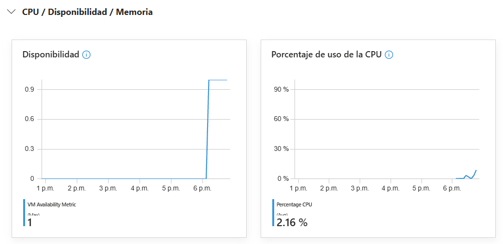
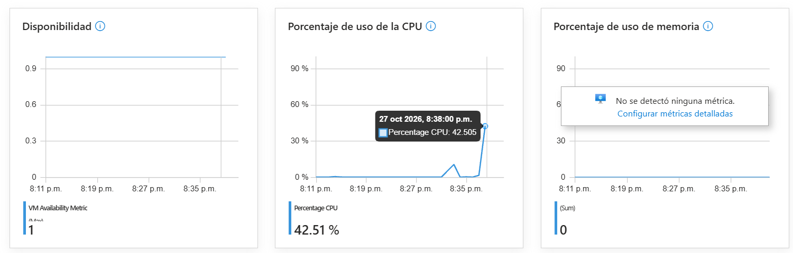
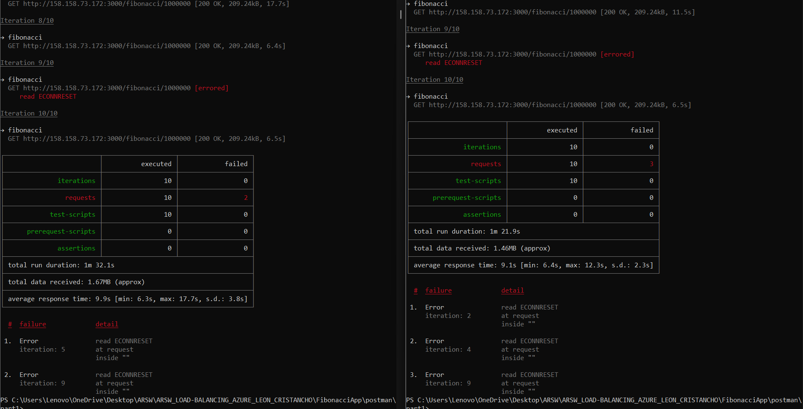
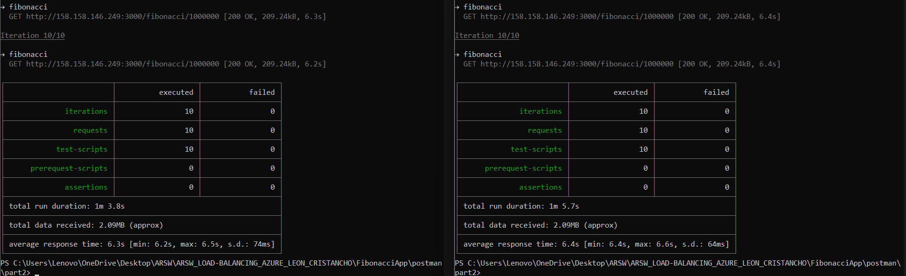

### Escuela Colombiana de Ingeniería
### Arquitecturas de Software - ARSW

## Escalamiento en Azure con Maquinas Virtuales, Sacale Sets y Service Plans

### Dependencias
* Cree una cuenta gratuita dentro de Azure. Para hacerlo puede guiarse de esta [documentación](https://azure.microsoft.com/es-es/free/students/). Al hacerlo usted contará con $100 USD para gastar durante 12 meses.

### Parte 0 - Entendiendo el escenario de calidad

Adjunto a este laboratorio usted podrá encontrar una aplicación totalmente desarrollada que tiene como objetivo calcular el enésimo valor de la secuencia de Fibonnaci.

**Escalabilidad**
Cuando un conjunto de usuarios consulta un enésimo número (superior a 1000000) de la secuencia de Fibonacci de forma concurrente y el sistema se encuentra bajo condiciones normales de operación, todas las peticiones deben ser respondidas y el consumo de CPU del sistema no puede superar el 70%.

### Parte 1 - Escalabilidad vertical

1. Diríjase a el [Portal de Azure](https://portal.azure.com/) y a continuación cree una maquina virtual con las características básicas descritas en la imágen 1 y que corresponden a las siguientes:
    * Resource Group = SCALABILITY_LAB
    * Virtual machine name = VERTICAL-SCALABILITY
    * Image = Ubuntu Server 
    * Size = Standard B1ls
    * Username = scalability_lab
    * SSH publi key = Su llave ssh publica


2. Para conectarse a la VM use el siguiente comando, donde las `x` las debe remplazar por la IP de su propia VM (Revise la sección "Connect" de la virtual machine creada para tener una guía más detallada).

    `ssh scalability_lab@xxx.xxx.xxx.xxx`

3. Instale node, para ello siga la sección *Installing Node.js and npm using NVM* que encontrará en este [enlace](https://linuxize.com/post/how-to-install-node-js-on-ubuntu-18.04/).
4. Para instalar la aplicación adjunta al Laboratorio, suba la carpeta `FibonacciApp` a un repositorio al cual tenga acceso y ejecute estos comandos dentro de la VM:

    `git clone <your_repo>`

    `cd <your_repo>/FibonacciApp`

    `npm install`

5. Para ejecutar la aplicación puede usar el comando `npm FibinacciApp.js`, sin embargo una vez pierda la conexión ssh la aplicación dejará de funcionar. Para evitar ese compartamiento usaremos *forever*. Ejecute los siguientes comando dentro de la VM.

    ` node FibonacciApp.js`

6. Antes de verificar si el endpoint funciona, en Azure vaya a la sección de *Networking* y cree una *Inbound port rule* tal como se muestra en la imágen. Para verificar que la aplicación funciona, use un browser y user el endpoint `http://xxx.xxx.xxx.xxx:3000/fibonacci/6`. La respuesta debe ser `The answer is 8`.


7. La función que calcula en enésimo número de la secuencia de Fibonacci está muy mal construido y consume bastante CPU para obtener la respuesta. Usando la consola del Browser documente los tiempos de respuesta para dicho endpoint usando los siguintes valores:
    * 1000000
    * 1010000
    * 1020000
    * 1030000
    * 1040000
    * 1050000
    * 1060000
    * 1070000
    * 1080000
    * 1090000    

8. Dírijase ahora a Azure y verifique el consumo de CPU para la VM. (Los resultados pueden tardar 5 minutos en aparecer).


9. Ahora usaremos Postman para simular una carga concurrente a nuestro sistema. Siga estos pasos.
    * Instale newman con el comando `npm install newman -g`. Para conocer más de Newman consulte el siguiente [enlace](https://learning.getpostman.com/docs/postman/collection-runs/command-line-integration-with-newman/).
    * Diríjase hasta la ruta `FibonacciApp/postman` en una maquina diferente a la VM.
    * Para el archivo `[ARSW_LOAD-BALANCING_AZURE].postman_environment.json` cambie el valor del parámetro `VM1` para que coincida con la IP de su VM.
    * Ejecute el siguiente comando.

    ```
    newman run ARSW_LOAD-BALANCING_AZURE.postman_collection.json -e [ARSW_LOAD-BALANCING_AZURE].postman_environment.json -n 10 &
    newman run ARSW_LOAD-BALANCING_AZURE.postman_collection.json -e [ARSW_LOAD-BALANCING_AZURE].postman_environment.json -n 10
    ```

10. La cantidad de CPU consumida es bastante grande y un conjunto considerable de peticiones concurrentes pueden hacer fallar nuestro servicio. Para solucionarlo usaremos una estrategia de Escalamiento Vertical. En Azure diríjase a la sección *size* y a continuación seleccione el tamaño `B2ms`.


11. Una vez el cambio se vea reflejado, repita el paso 7, 8 y 9.
12. Evalue el escenario de calidad asociado al requerimiento no funcional de escalabilidad y concluya si usando este modelo de escalabilidad logramos cumplirlo.
13. Vuelva a dejar la VM en el tamaño inicial para evitar cobros adicionales.

**Preguntas**

1. ¿Cuántos y cuáles recursos crea Azure junto con la VM?

    **Respuesta:** Además de la máquina virtual, Azure crea **6 recursos** asociados, para un total de **7** en el grupo `SCALABILITY_LAB`:
    1. **Máquina virtual** (`VERTICAL-SCALABILITY`).
    2. **Disco administrado del SO** (`VERTICAL-SCALABILITY_OsDisk_...`).
    3. **Interfaz de red (NIC)**.
    4. **Dirección IP pública** (`VERTICAL-SCALABILITY-ip`, en nuestro caso 158.158.73.172).
    5. **Grupo de seguridad de red (NSG)** (`VERTICAL-SCALABILITY-nsg`).
    6. **Red virtual con su subred** (`vnet-spaincentral-1` / `snet-spaincentral-1`).
    7. **Clave SSH** (`VERTICAL-SCALABILITY_key`), porque se generó un par de claves nuevo durante la creación.

2. ¿Brevemente describa para qué sirve cada recurso?

    **Respuesta:**
    * **Máquina virtual:** el cómputo (vCPU y memoria) donde corren el sistema operativo Ubuntu y la FibonacciApp.
    * **Disco del SO:** almacenamiento persistente donde viven el sistema operativo, Node.js y la aplicación; sobrevive a reinicios y a cambios de tamaño.
    * **Interfaz de red (NIC):** conecta la VM con la red virtual; a ella se asocian la IP privada, la IP pública y el NSG.
    * **IP pública:** dirección accesible desde Internet para entrar por SSH (puerto 22) y consumir el servicio (puerto 3000).
    * **NSG:** firewall de capa 3/4 con reglas de entrada y salida que permiten o deniegan tráfico según IP, puerto y protocolo.
    * **Red virtual y subred:** red privada y aislada en Azure donde se le asigna una IP privada a la VM y desde la que se puede comunicar con otros recursos.
    * **Clave SSH:** guarda la llave pública que se instala en la VM; con la llave privada (`.pem`) nos autenticamos sin contraseña.

3. ¿Al cerrar la conexión ssh con la VM, por qué se cae la aplicación que ejecutamos con el comando `npm FibonacciApp.js`? ¿Por qué debemos crear un *Inbound port rule* antes de acceder al servicio?

    **Respuesta:** El proceso de Node se lanza en primer plano como **hijo de la sesión de shell** abierta por SSH. Al cerrar la conexión, la terminal envía la señal `SIGHUP` a los procesos de esa sesión y estos terminan, por lo que la aplicación se cae. Para evitarlo se usa un gestor de procesos como `forever` (o `pm2`, `nohup`, `systemd`), que ejecuta la aplicación como demonio desacoplado de la terminal y además la reinicia si falla.

    El *Inbound port rule* es necesario porque el NSG, por defecto, **deniega todo el tráfico entrante** (`DenyAllInBound`) salvo el que se haya permitido explícitamente (al crear la VM solo se abre el 22 para SSH). La aplicación escucha en el puerto **3000**, así que sin una regla que permita TCP/3000 las peticiones del navegador se bloquean antes de llegar a la VM.

4. Adjunte tabla de tiempos e interprete por qué la función tarda tando tiempo.

    **Respuesta:**

    | n | Tiempo de respuesta |
    |---|---|
    | 1.000.000 | 7,11 s |
    | 1.010.000 | 6,39 s |
    | 1.020.000 | 6,45 s |
    | 1.030.000 | 6,68 s |
    | 1.040.000 | 6,91 s |
    | 1.050.000 | 6,97 s |
    | 1.060.000 | 7,06 s |
    | 1.070.000 | 7,23 s |
    | 1.080.000 | 7,29 s |
    | 1.090.000 | 7,63 s |

    El tiempo crece de forma sostenida con `n` (la primera consulta es algo mayor por ejecutarse en frío). La función es lenta porque:
    * Hace **`n` iteraciones** (más de un millón) sin memoización ni caché, de modo que cada petición recalcula toda la secuencia desde cero.
    * Cada iteración suma enteros de **precisión arbitraria** (`big-integer`). F(1.000.000) tiene unos **209.000 dígitos**, así que cada suma es más costosa a medida que el número crece: el costo total es aproximadamente O(n²) en operaciones sobre dígitos, no O(n).
    * Al final convierte ese número gigante a `String` (`toString()`) y lo envía como una respuesta de ~209 kB.
    * El cálculo es **síncrono y corre en el único hilo del event loop de Node.js**, por lo que mientras se calcula una petición el servidor no puede atender ninguna otra.

5. Adjunte imágen del consumo de CPU de la VM e interprete por qué la función consume esa cantidad de CPU.

    **Respuesta:**

    

    *Tamaño inicial (`B2ats_v2`) tras las consultas secuenciales del paso 7: promedio de 2,16 % en la ventana mostrada, con un pico al final.*

    

    *Tamaño escalado (`B2als_v2`) durante la prueba de carga: pico de **42,5 %**.*

    El cálculo es puramente **CPU-bound**: no hay E/S ni esperas, solo sumas de enteros grandes en un ciclo muy largo, así que mientras se resuelve una petición el núcleo que la ejecuta está prácticamente al 100 %. Como Node.js ejecuta el código JavaScript en **un único hilo**, solo puede ocupar **un núcleo** de los 2 vCPU de la VM; por eso, a nivel de VM, el uso tiende a un techo cercano al **50 %** (el pico de 42,5 % lo confirma). Los promedios bajos (2,16 %) se deben a que Azure agrega la métrica por minuto y las consultas individuales duran ~7 s seguidas de periodos de inactividad, lo que diluye el pico en el promedio.

6. Adjunte la imagen del resumen de la ejecución de Postman. Interprete:
    * Tiempos de ejecución de cada petición.
    * Si hubo fallos documentelos y explique.

    **Respuesta:**

    

    | Métrica (20 peticiones en total) | Ventana izquierda | Ventana derecha |
    |---|---|---|
    | Peticiones ejecutadas | 10 | 10 |
    | Peticiones fallidas | 2 (iteraciones 5 y 9) | 3 (iteraciones 2, 4 y 9) |
    | Duración total | 1 m 32,1 s | 1 m 21,9 s |
    | Tiempo promedio | 9,9 s | 9,1 s |
    | Mínimo / máximo | 6,3 s / 17,7 s | 6,4 s / 12,3 s |
    | Desviación estándar | 3,8 s | 2,3 s |

    * **Tiempos:** sin concurrencia cada petición tarda ~6,3 s. Con dos ejecuciones en paralelo el promedio sube a 9,1–9,9 s y el máximo llega a 17,7 s (casi el triple). Como Node atiende el cálculo en un solo hilo, cuando llegan dos peticiones a la vez la segunda **espera en cola** a que termine la primera; la alta desviación estándar refleja justamente si a una petición le tocó esperar o no.
    * **Fallos:** fallaron **5 de 20 peticiones (25 %)** con el error `read ECONNRESET`, es decir, la conexión TCP se cerró o reinició antes de recibir la respuesta. El proceso Node está bloqueado calculando y no alcanza a atender a tiempo las conexiones en espera; además la VM inicial tiene solo 1 GiB de RAM y cada respuesta genera strings de ~209 kB, lo que añade presión de memoria. Solo se respondió el 75 % de las peticiones, de modo que **no se cumple** el escenario de calidad.

7. ¿Cuál es la diferencia entre los tamaños `B2ms` y `B1ls` (no solo busque especificaciones de infraestructura)?

    **Respuesta:**

    | | `B1ls` | `B2ms` |
    |---|---|---|
    | vCPU | 1 | 2 |
    | Memoria | 0,5 GiB | 8 GiB |
    | Rendimiento base de CPU | 5 % | 60 % |
    | Créditos de CPU acumulables (máx.) | 72 | 864 |
    | Discos de datos / IOPS máx. | 2 / 160 | 4 / 1.920 |
    | Costo aproximado | ~US$ 3,8/mes | ~US$ 60/mes |

    Ambas son de la **serie B (burstable)**: no están pensadas para un uso sostenido de CPU, sino para cargas que normalmente están ociosas y ocasionalmente tienen picos. Funcionan con **créditos de CPU**: mientras la VM consume menos que su línea base acumula créditos y, cuando hay un pico, los gasta para usar hasta el 100 % de la CPU; si se agotan, la VM queda **limitada a su rendimiento base**. La gran diferencia práctica es que `B1ls` tiene una línea base de solo el 5 %, por lo que con un cálculo como el de Fibonacci se queda sin créditos rápidamente y se vuelve muy lenta, mientras que `B2ms` sostiene hasta el 60 % de forma continua y acumula muchos más créditos. `B1ls` está pensada para pruebas o servicios casi inactivos; `B2ms`, para servidores web pequeños, bases de datos de desarrollo o entornos de prueba con carga moderada, a un costo unas 16 veces mayor.

    En nuestra suscripción (Azure for Students, Spain Central) se usaron los equivalentes de la serie B v2: `B2ats_v2` (2 vCPU, 1 GiB, US$ 8,91/mes) y `B2als_v2` (2 vCPU, 4 GiB, US$ 35,70/mes). Aquí el escalado no añadió núcleos, sino memoria y una línea base de CPU mayor, a cuatro veces el costo.

8. ¿Aumentar el tamaño de la VM es una buena solución en este escenario?, ¿Qué pasa con la FibonacciApp cuando cambiamos el tamaño de la VM?

    **Respuesta:** **No es una buena solución.** El problema no es la falta de recursos sino que la aplicación es **monohilo y CPU-bound**: Node.js usa un único núcleo para el cálculo, así que añadir vCPUs no le sirve (los núcleos extra quedan ociosos) y añadir RAM tampoco acelera las sumas. Solo una CPU más rápida o con más línea base mejora un poco el tiempo de una petición, pero las peticiones concurrentes siguen encolándose una tras otra. Además, el escalamiento vertical tiene un techo (el tamaño máximo de VM), su costo crece de forma desproporcionada y sigue habiendo un **único punto de falla**. Haría falta cambiar el código (algoritmo eficiente, caché, `worker_threads` o `cluster`) o escalar horizontalmente.

    Al cambiar el tamaño, Azure **reinicia la VM** (el portal lo advierte), por lo que la FibonacciApp **se detiene** y el servicio no está disponible durante el redimensionamiento. Como fue lanzada a mano, no vuelve a levantarse sola tras el reinicio: hay que reconectarse por SSH y volver a ejecutarla (a menos que se configure como servicio de `systemd` o con `forever`/`pm2` al arranque).

9. ¿Qué pasa con la infraestructura cuando cambia el tamaño de la VM? ¿Qué efectos negativos implica?

    **Respuesta:** Azure apaga la VM y, si el nuevo tamaño no está disponible en el host físico actual, la desasigna y la **reubica en otro hardware** compatible antes de volver a encenderla. El disco del SO, la NIC, la VNet y el NSG se conservan; la IP pública también si es estática (si es dinámica podría cambiar), y se pierde el contenido del disco temporal.

    Efectos negativos:
    * **Tiempo de inactividad (downtime)**: el servicio deja de responder mientras se aplica el cambio; con una sola VM es una interrupción total.
    * Se pierden los procesos en ejecución y las conexiones activas; hay que levantar de nuevo la aplicación.
    * Puede que el tamaño deseado no esté disponible en la región o en el clúster y el cambio falle.
    * Es un cambio **manual y reactivo**: no se adapta automáticamente a la carga, y volver al tamaño inicial (paso 13) implica otro reinicio.
    * Aumenta el costo de forma desproporcionada (en nuestro caso 4 veces) y se mantiene el **único punto de falla**.

10. ¿Hubo mejora en el consumo de CPU o en los tiempos de respuesta? Si/No ¿Por qué?

    **Respuesta:** **No hubo una mejora significativa.** En nuestro caso ambos tamaños (`B2ats_v2` y `B2als_v2`) tienen **2 vCPU**; el escalamiento solo aumentó la memoria (1 → 4 GiB) y la línea base de CPU. Como la aplicación es monohilo, el tiempo de una petición depende de la velocidad de **un** núcleo, que es esencialmente la misma, así que cada cálculo sigue tardando ~6–7 s y con peticiones concurrentes se siguen encolando. El consumo de CPU tampoco baja: en la VM escalada el pico fue de **42,5 %**, es decir, un núcleo prácticamente saturado y el otro ocioso. La memoria adicional reduce la presión al construir las respuestas grandes, pero no ataca la causa del problema: un cálculo costoso y bloqueante en un único hilo. Con el `B1ls` → `B2ms` original de la guía la mejora sería más visible (de una línea base del 5 % a una del 60 %), pero por la misma razón seguiría sin escalar con la concurrencia.

11. Aumente la cantidad de ejecuciones paralelas del comando de postman a `4`. ¿El comportamiento del sistema es porcentualmente mejor?

    **Respuesta:** **No, el comportamiento no es porcentualmente mejor.** Con 4 clientes concurrentes llegan 4 peticiones casi al mismo tiempo a un único proceso Node que solo puede calcular una a la vez: la última de la cola espera los cálculos de las tres anteriores (≈ 4 × 6,5 s ≈ 26 s), así que los tiempos promedio y máximo crecen aproximadamente en proporción al número de clientes. Al aumentar la espera, más conexiones se reinician o superan el tiempo límite (`ECONNRESET`), por lo que el porcentaje de fallos se mantiene o aumenta respecto al 25 % observado con 2 ejecuciones. El throughput (peticiones respondidas por segundo) se mantiene prácticamente constante porque está limitado por un núcleo, y tener más vCPU o RAM no lo cambia. Esto confirma que el escalamiento vertical no resuelve el requisito de escalabilidad.

### Parte 2 - Escalabilidad horizontal

#### Crear el Balanceador de Carga

Antes de continuar puede eliminar el grupo de recursos anterior para evitar gastos adicionales y realizar la actividad en un grupo de recursos totalmente limpio.

1. El Balanceador de Carga es un recurso fundamental para habilitar la escalabilidad horizontal de nuestro sistema, por eso en este paso cree un balanceador de carga dentro de Azure tal cual como se muestra en la imágen adjunta.


2. A continuación cree un *Backend Pool*, guiese con la siguiente imágen.


3. A continuación cree un *Health Probe*, guiese con la siguiente imágen.


4. A continuación cree un *Load Balancing Rule*, guiese con la siguiente imágen.


5. Cree una *Virtual Network* dentro del grupo de recursos, guiese con la siguiente imágen.


#### Crear las maquinas virtuales (Nodos)

Ahora vamos a crear 3 VMs (VM1, VM2 y VM3) con direcciones IP públicas standar en 3 diferentes zonas de disponibilidad. Después las agregaremos al balanceador de carga.

1. En la configuración básica de la VM guíese por la siguiente imágen. Es importante que se fije en la "Avaiability Zone", donde la VM1 será 1, la VM2 será 2 y la VM3 será 3.


2. En la configuración de networking, verifique que se ha seleccionado la *Virtual Network*  y la *Subnet* creadas anteriormente. Adicionalmente asigne una IP pública y no olvide habilitar la redundancia de zona.


3. Para el Network Security Group seleccione "avanzado" y realice la siguiente configuración. No olvide crear un *Inbound Rule*, en el cual habilite el tráfico por el puerto 3000. Cuando cree la VM2 y la VM3, no necesita volver a crear el *Network Security Group*, sino que puede seleccionar el anteriormente creado.


4. Ahora asignaremos esta VM a nuestro balanceador de carga, para ello siga la configuración de la siguiente imágen.


5. Finalmente debemos instalar la aplicación de Fibonacci en la VM. para ello puede ejecutar el conjunto de los siguientes comandos, cambiando el nombre de la VM por el correcto

```
git clone https://github.com/daprieto1/ARSW_LOAD-BALANCING_AZURE.git

curl -o- https://raw.githubusercontent.com/creationix/nvm/v0.34.0/install.sh | bash
source /home/vm1/.bashrc
nvm install node

cd ARSW_LOAD-BALANCING_AZURE/FibonacciApp
npm install

npm install forever -g
forever start FibonacciApp.js
```

Realice este proceso para las 3 VMs, por ahora lo haremos a mano una por una, sin embargo es importante que usted sepa que existen herramientas para aumatizar este proceso, entre ellas encontramos Azure Resource Manager, OsDisk Images, Terraform con Vagrant y Paker, Puppet, Ansible entre otras.

#### Probar el resultado final de nuestra infraestructura

1. Porsupuesto el endpoint de acceso a nuestro sistema será la IP pública del balanceador de carga, primero verifiquemos que los servicios básicos están funcionando, consuma los siguientes recursos:

```
http://52.155.223.248/
http://52.155.223.248/fibonacci/1
```

2. Realice las pruebas de carga con `newman` que se realizaron en la parte 1 y haga un informe comparativo donde contraste: tiempos de respuesta, cantidad de peticiones respondidas con éxito, costos de las 2 infraestrucruras, es decir, la que desarrollamos con balanceo de carga horizontal y la que se hizo con una maquina virtual escalada.

3. Agregue una 4 maquina virtual y realice las pruebas de newman, pero esta vez no lance 2 peticiones en paralelo, sino que incrementelo a 4. Haga un informe donde presente el comportamiento de la CPU de las 4 VM y explique porque la tasa de éxito de las peticiones aumento con este estilo de escalabilidad.

```
newman run ARSW_LOAD-BALANCING_AZURE.postman_collection.json -e [ARSW_LOAD-BALANCING_AZURE].postman_environment.json -n 10 &
newman run ARSW_LOAD-BALANCING_AZURE.postman_collection.json -e [ARSW_LOAD-BALANCING_AZURE].postman_environment.json -n 10 &
newman run ARSW_LOAD-BALANCING_AZURE.postman_collection.json -e [ARSW_LOAD-BALANCING_AZURE].postman_environment.json -n 10 &
newman run ARSW_LOAD-BALANCING_AZURE.postman_collection.json -e [ARSW_LOAD-BALANCING_AZURE].postman_environment.json -n 10
```

**Preguntas**

* ¿Cuáles son los tipos de balanceadores de carga en Azure y en qué se diferencian?, ¿Qué es SKU, qué tipos hay y en qué se diferencian?, ¿Por qué el balanceador de carga necesita una IP pública?

    **Respuesta:** Azure ofrece cuatro servicios de balanceo, que se diferencian por la capa OSI en la que trabajan y por su alcance (regional o global):

    | Servicio | Capa | Alcance | Uso típico |
    |---|---|---|---|
    | **Azure Load Balancer** | 4 (TCP/UDP) | Regional | Repartir conexiones entre VMs; muy baja latencia y alto rendimiento. Es el que usamos. |
    | **Application Gateway** | 7 (HTTP/HTTPS) | Regional | Enrutamiento por URL o host, terminación TLS, afinidad por cookie y firewall de aplicaciones web (WAF). |
    | **Azure Front Door** | 7 (HTTP/HTTPS) | Global | Aplicaciones web distribuidas en varias regiones, con CDN, aceleración y WAF en el borde. |
    | **Traffic Manager** | DNS | Global | Dirige a los clientes al endpoint más cercano o disponible resolviendo DNS; no ve el tráfico. |

    Además, el Load Balancer puede ser **público** (recibe tráfico de Internet, como el nuestro) o **interno** (solo IPs privadas dentro de la VNet).

    El **SKU** (*Stock Keeping Unit*) es el nivel o edición del recurso, que determina sus capacidades, su SLA y su precio. Para el Load Balancer existen:
    * **Básico:** gratuito, hasta 300 instancias, sin zonas de disponibilidad ni SLA, abierto por defecto. Azure lo **retiró el 30 de septiembre de 2025**, por eso ya no se ofrece.
    * **Estándar:** el que usamos. Hasta 1.000 instancias, soporta **zonas de disponibilidad** (frontend zonal o redundante en zonas), sondeos HTTP/HTTPS, métricas en Azure Monitor, SLA del 99,99 % y es **seguro por defecto** (cerrado al tráfico entrante hasta que un NSG lo permita). Se cobra por hora y por datos procesados.
    * **Gateway:** pensado para encadenar de forma transparente dispositivos virtuales de red (firewalls, inspección de paquetes) delante de otro balanceador.

    El balanceador necesita una **IP pública** porque es el **único punto de entrada** al sistema para los clientes de Internet: ellos no conocen ni deben conocer las IPs de cada VM, solo la del frontend (en nuestro caso 158.158.146.249), y el balanceador reenvía cada conexión a un nodo sano del backend pool. Así se pueden agregar, quitar o reemplazar VMs sin que los clientes cambien de dirección.

* ¿Cuál es el propósito del *Backend Pool*?

    **Respuesta:** Es el **conjunto de recursos (NICs/IPs de las VMs) entre los que el balanceador reparte el tráfico**. En nuestro caso, `BackendPool-Fibonacci` agrupa las interfaces de red de `VM1`, `VM2` y `VM3` dentro de `VNet-Fibonacci`. Escalar horizontalmente consiste justamente en agregar o quitar instancias del pool: el balanceador las incluye o excluye de la distribución sin cambiar el punto de entrada.

* ¿Cuál es el propósito del *Health Probe*?

    **Respuesta:** Permite al balanceador **saber qué nodos del backend están sanos** y solo enviarles tráfico a ellos. Cada cierto intervalo consulta a cada instancia; si una no responde correctamente un número de veces seguido, se marca como no disponible y deja de recibir conexiones nuevas hasta que vuelva a responder. En nuestro caso `Probe-Fibonacci` hace un **GET HTTP a `/fibonacci/6` en el puerto 3000 cada 5 segundos**, lo que verifica no solo que la VM esté encendida sino que la aplicación realmente responda. Esto da **tolerancia a fallos**: si una VM o su aplicación se cae, los usuarios no lo notan.

* ¿Cuál es el propósito de la *Load Balancing Rule*? ¿Qué tipos de sesión persistente existen, por qué esto es importante y cómo puede afectar la escalabilidad del sistema?.

    **Respuesta:** La regla define **cómo se distribuye el tráfico**: une una IP de frontend y un puerto/protocolo de entrada (TCP 3000) con un backend pool y un puerto de destino (3000), indica qué health probe usar y configura el tiempo de inactividad y la persistencia de sesión. Sin ella el balanceador existe pero no reenvía nada.

    Por defecto el balanceador distribuye con un **hash de 5 tuplas** (IP origen, puerto origen, IP destino, puerto destino, protocolo). Los tipos de persistencia de sesión son:
    * **Ninguna** (hash de 5 tuplas, la que usamos): cada conexión nueva puede ir a cualquier VM.
    * **IP de cliente** (hash de 2 tuplas: IP origen e IP destino): todas las conexiones de una misma IP van a la misma VM.
    * **IP de cliente y protocolo** (hash de 3 tuplas: IP origen, IP destino y protocolo): igual que la anterior, pero distinguiendo el protocolo.

    Es importante cuando la aplicación **guarda estado en memoria** del servidor (sesiones de usuario, carritos de compra, cachés locales): si un cliente cambia de VM, pierde ese estado. Sin embargo, la persistencia **afecta la escalabilidad**, porque la carga deja de repartirse uniformemente: muchos clientes detrás de una misma IP (NAT corporativo, proxy) terminan todos en la misma VM, que se satura mientras otras quedan ociosas, y las VMs nuevas tardan en recibir tráfico. Lo ideal es diseñar servicios **sin estado** (como la FibonacciApp) y guardar el estado compartido en un almacén externo (Redis, base de datos), dejando la persistencia en *Ninguna*.

* ¿Qué es una *Virtual Network*? ¿Qué es una *Subnet*? ¿Para qué sirven los *address space* y *address range*?

    **Respuesta:**
    * **Virtual Network (VNet):** red privada y aislada lógicamente dentro de Azure, en una región, que permite que los recursos (VMs, balanceador) se comuniquen entre sí con IPs privadas, con Internet y con redes locales (VPN, peering), con control sobre el direccionamiento, el enrutamiento y la seguridad. En nuestro caso, `VNet-Fibonacci`.
    * **Subnet:** segmento de la VNet con un sub-rango de direcciones, a la que se conectan los recursos. Sirve para organizar y aislar cargas (por ejemplo, frontend, backend y datos) y aplicarles NSGs o tablas de rutas distintas. Nuestras VMs están en `snet-spaincentral-2`.
    * **Address space:** el bloque (o bloques) de IPs privadas en notación CIDR que pertenecen a toda la VNet, por ejemplo `10.0.0.0/16` (65.536 direcciones). No debe solaparse con otras redes con las que se vaya a conectar.
    * **Address range:** el rango CIDR de cada subred, que debe estar contenido en el address space y no solaparse con otras subredes, por ejemplo `10.0.1.0/24` (256 direcciones, de las cuales Azure reserva 5). Determina cuántos recursos caben en la subred.

* ¿Qué son las *Availability Zone* y por qué seleccionamos 3 diferentes zonas?. ¿Qué significa que una IP sea *zone-redundant*?

    **Respuesta:** Las **zonas de disponibilidad** son ubicaciones físicamente separadas dentro de una misma región de Azure, cada una con uno o más datacenters con **alimentación eléctrica, refrigeración y red independientes**, conectadas entre sí con baja latencia. Seleccionamos **3 zonas distintas** (VM1 en la zona 1, VM2 en la 2 y VM3 en la 3) para que una falla en un datacenter completo (corte eléctrico, incendio, falla de red) solo afecte a una VM: las otras dos siguen atendiendo y el health probe saca la caída del pool. Así se elimina el punto único de falla y se obtiene un SLA del 99,99 % para las VMs.

    Una IP **zone-redundant** es una IP pública que **no está atada a una sola zona**: Azure la sirve simultáneamente desde todas las zonas de la región, de modo que sigue funcionando aunque una zona falle. Es fundamental para el frontend del balanceador, porque de nada serviría repartir las VMs en 3 zonas si la IP de entrada dependiera de una sola. Por el contrario, una IP **zonal** solo vive en una zona y cae con ella.

* ¿Cuál es el propósito del *Network Security Group*?

    **Respuesta:** El NSG es un **firewall distribuido** que filtra el tráfico de red que entra y sale de las subredes o NICs a las que está asociado. Contiene reglas con prioridad (la de menor número gana) que **permiten o deniegan** tráfico según IP de origen y destino, puerto y protocolo, además de reglas por defecto como `AllowVnetInBound`, `AllowAzureLoadBalancerInBound` y `DenyAllInBound`. En este laboratorio se usa para abrir solo lo necesario: SSH (22) para administrar las VMs y **TCP 3000** para la aplicación (regla `Allow-Port-3000`), bloqueando todo lo demás. Es especialmente importante con el Load Balancer Estándar, que es seguro por defecto y no deja pasar tráfico al backend si el NSG no lo permite.

* Informe de newman 1 (Punto 2)

    **Respuesta:** Se repitió la prueba de la parte 1 (dos ejecuciones de newman en paralelo, `-n 10` cada una, `GET /fibonacci/1000000`), ahora contra la IP del balanceador.

    

    **Tiempos de respuesta y tasa de éxito:**

    | Métrica (2 × 10 peticiones) | Escalamiento vertical (1 VM) | Escalamiento horizontal (LB + 3 VMs) |
    |---|---|---|
    | Peticiones exitosas | **15 / 20 (75 %)** | **20 / 20 (100 %)** |
    | Peticiones fallidas | 5 (`ECONNRESET`) | 0 |
    | Tiempo promedio | 9,1 s – 9,9 s | 6,3 s – 6,4 s |
    | Mínimo / máximo | 6,3 s / 17,7 s | 6,2 s / 6,6 s |
    | Desviación estándar | 2,3 s – 3,8 s | 64 ms – 74 ms |
    | Duración total de cada ejecución | 1 m 21,9 s – 1 m 32,1 s | 1 m 3,8 s – 1 m 5,7 s |

    Con una sola VM, las dos ejecuciones compiten por el mismo proceso Node monohilo: las peticiones se encolan, el tiempo promedio sube un 50 % y una de cada cuatro falla. Con el balanceador, cada petición concurrente cae en una VM distinta, de modo que **ninguna espera detrás de otro cálculo**: el tiempo promedio es el mismo que el de una petición aislada (~6,3 s), la dispersión es de milisegundos y la tasa de éxito es del 100 %. Es decir, el escenario de calidad (responder todas las peticiones sin saturar la CPU) se cumple con escalamiento horizontal y no con el vertical.

    **Costos aproximados (precios de lista, Spain Central, 730 h/mes):**

    | Componente | Vertical | Horizontal |
    |---|---|---|
    | Cómputo | 1 × `B2als_v2` = US$ 35,70 | 3 × `B2ats_v2` = US$ 26,73 |
    | IPs públicas estándar (~US$ 3,65 c/u) | 1 = US$ 3,65 | 4 (3 VMs + LB) = US$ 14,60 |
    | Load Balancer Estándar (~US$ 0,025/h por las primeras 5 reglas + US$ 0,005/GB procesado) | — | ≈ US$ 18,25 |
    | **Total aproximado** | **≈ US$ 39/mes** | **≈ US$ 60/mes** |

    *Sin contar discos y tráfico de salida, que son similares en ambos casos.*

    La infraestructura horizontal cuesta ~50 % más, pero a cambio responde el 100 % de las peticiones, con menor latencia, **sin punto único de falla** (3 zonas y health probe), **sin downtime para escalar** (basta con agregar otra VM al pool) y con un costo que crece **linealmente**: cada nodo adicional cuesta lo mismo y aporta la misma capacidad. Además, las IPs públicas de cada VM solo se usaron para administrar por SSH; podrían eliminarse (usando Azure Bastion o un jumpbox) para reducir el costo y la superficie de ataque. En el vertical, en cambio, pagar 4 veces más por la VM no mejoró la tasa de éxito porque la aplicación no aprovecha los recursos extra.

* Presente el Diagrama de Despliegue de la solución.

    **Respuesta:**

    ```mermaid
    flowchart TB
        cliente["Cliente<br/>(navegador / newman)"]

        subgraph azure["Azure – Región Spain Central – Grupo de recursos SCALABILITY_LAB_HORIZONTAL"]
            ip["IP pública zone-redundant<br/>IP-LB-Fibonacci<br/>158.158.146.249"]

            subgraph lb["Load Balancer Estándar público: LB-Fibonacci"]
                fe["Frontend-Fibonacci"]
                rule["Rule-Fibonacci<br/>TCP 3000 → 3000<br/>Persistencia: Ninguna"]
                probe["Probe-Fibonacci<br/>HTTP :3000 /fibonacci/6 cada 5 s"]
                pool["BackendPool-Fibonacci"]
            end

            subgraph vnet["VNet-Fibonacci (10.0.0.0/16)"]
                subgraph subnet["Subnet snet-spaincentral-2 (10.0.1.0/24) + NSG (22, 3000)"]
                    subgraph z1["Zona 1"]
                        vm1["VM1-Fibonacci<br/>Ubuntu 24.04<br/>Node.js + forever<br/>FibonacciApp :3000"]
                    end
                    subgraph z2["Zona 2"]
                        vm2["VM2-Fibonacci<br/>Ubuntu 24.04<br/>Node.js + forever<br/>FibonacciApp :3000"]
                    end
                    subgraph z3["Zona 3"]
                        vm3["VM3-Fibonacci<br/>Ubuntu 24.04<br/>Node.js + forever<br/>FibonacciApp :3000"]
                    end
                end
            end
        end

        cliente -- "HTTP :3000 /fibonacci/{n}" --> ip --> fe --> rule --> pool
        pool --> vm1
        pool --> vm2
        pool --> vm3
        probe -. "health check" .-> vm1
        probe -. "health check" .-> vm2
        probe -. "health check" .-> vm3
    ```

    El cliente solo conoce la IP pública del balanceador. La regla de balanceo reparte cada conexión TCP al puerto 3000 entre las VMs del backend pool que el health probe reporta como sanas. Las tres VMs son idénticas, sin estado, viven en la misma VNet/subred protegida por el NSG y están distribuidas en tres zonas de disponibilidad distintas.


